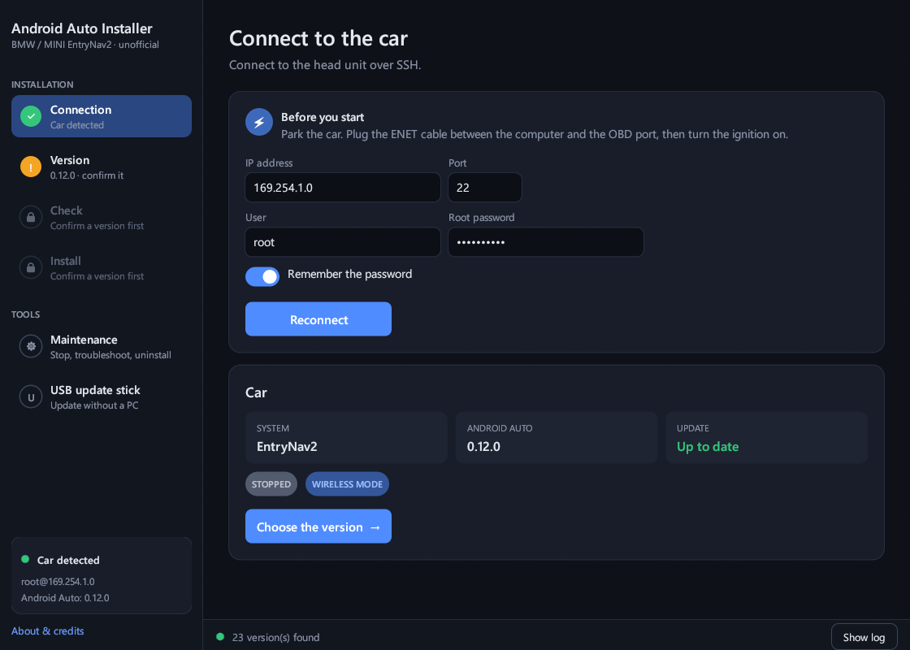
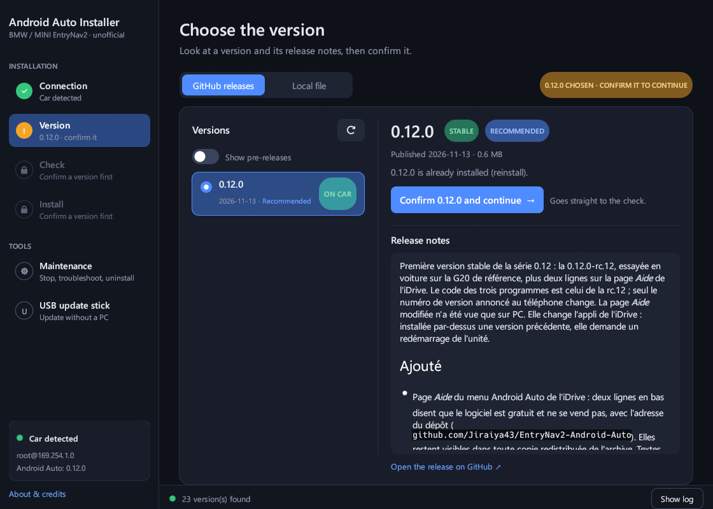

# Android Auto Installer for EntryNav2

Unofficial desktop app for Windows and macOS. It installs and updates
[EntryNav2-Android-Auto](https://github.com/Jiraiya43/EntryNav2-Android-Auto) on BMW / MINI EntryNav2 head units,
without using a command line.

> [!WARNING]
> EntryNav2-Android-Auto is experimental and changes the head unit's system. Use it only on your own car,
> parked with the ignition on, and never turn the ignition off during an installation. No warranty.

<p align="center">
  
  
</p>

## Download

Get the latest version from the [Releases](../../releases) page. The app is not signed, so the system warns you the
first time you open it.

### Windows

1. Download `EntryNav2-Installer-windows-x64.exe` and open it.
2. If "Windows protected your PC" appears, click **More info**, then **Run anyway**.

### macOS

1. Download the zip for your Mac: `EntryNav2-Installer-macos-apple-silicon.zip` (M1 and newer) or
   `EntryNav2-Installer-macos-intel.zip` (older Macs).
2. Unzip it and move **Android Auto Installer** to the **Applications** folder.
3. Open it. macOS blocks it the first time.
4. Go to **System Settings › Privacy & Security**, scroll down and click **Open Anyway**.

### Updates

When a new version of the installer is available, a banner appears at the top of the app. Click **Update**: the app
downloads the new version, checks it, replaces itself and restarts. Nothing on the car is changed.

On macOS, updates only work when the app is in the **Applications** folder.

## Requirements

- An ENET cable (OBD to Ethernet).
- SSH enabled on the head unit.
- The head unit's root password. It is not provided by this app or by the project.

## Usage

1. Park the car, plug the ENET cable into the OBD port and the computer, and turn the ignition on.
2. **Connect**: the default address is `169.254.1.0`, user `root`. The app shows the installed version and whether an
   update is available.
3. **Version**: choose a release from GitHub, or a local `.tar` archive.
4. **Check**: the archive is verified on the computer (project signature or SHA-256), then on the car with the
   project's compatibility test. Nothing is installed at this step.
5. **Install**: the current version is replaced and the head unit restarts. Your settings are kept.

Then on the iDrive: **Media › Android Auto › Start**.

The **Maintenance** page lets you stop Android Auto, re-enable it after the safety guard switched it off, disable it,
uninstall it or reboot the head unit.

## USB stick updates

Once 0.13.0-rc.10 or newer is installed on the car (with the cable, steps above), later updates can be done
from a USB stick. On the **USB stick** page, choose a release and a stick: the app copies the signed archive to
its root. In the car: **Media › Android Auto › Update from USB stick**.

## Safety

- Nothing is written to the car before the checks pass, and every change is confirmed.
- Only files installed by the project are replaced or removed.
- If a copy fails, the partial installation is removed. The head unit is never rebooted after a failure.
- The installation keeps running on the car if the cable is unplugged.

## Build from source

Requires [Rust](https://rustup.rs) (on Windows, with the Visual Studio C++ Build Tools).

```sh
cargo build --release
```

## Credits

- [EntryNav2-Android-Auto](https://github.com/Jiraiya43/EntryNav2-Android-Auto) by Jiraiya43 and contributors,
  licensed under PolyForm Noncommercial 1.0.0. This installer is an independent tool, not supported by them: report
  installer problems here.
- Not affiliated with BMW, MINI or Google. Android Auto is a trademark of Google LLC. BMW, MINI and iDrive are
  trademarks of BMW AG.

## Licence

[PolyForm Noncommercial 1.0.0](LICENSE.md), the same licence as EntryNav2-Android-Auto: free for noncommercial use,
never for sale.
